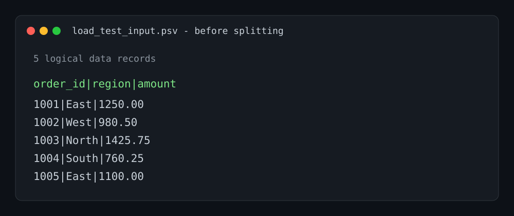
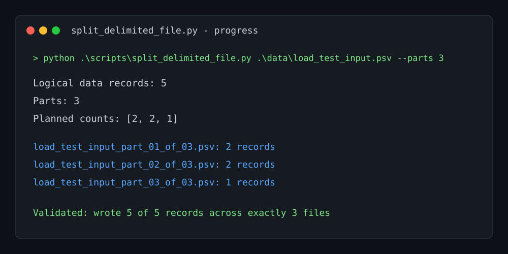
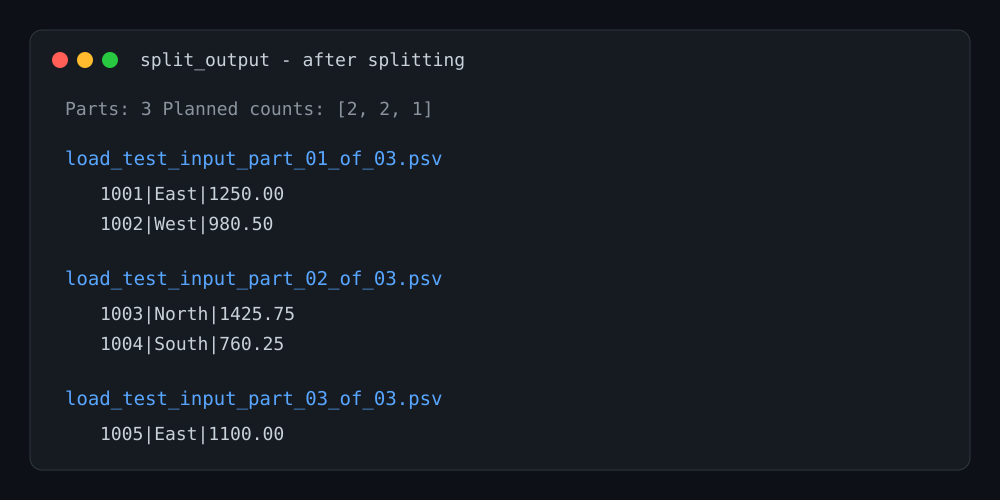

# Delimited File Split Utility

[](https://github.com/cbragdon/ADF_File_Load_Testor/actions/workflows/test.yml)

`split_delimited_file.py` divides one delimited file into an exact number of
smaller files.
It is intended to prepare evenly sized source files for Azure Data Factory load
tests without loading the complete source file into memory.

The script makes two streaming passes over the source: one to count logical
data records and another to write them. Every output file includes the source
header. Python's CSV parser preserves records whose quoted fields contain
embedded line breaks.

## Requirements

- Python 3.9 or later
- A delimited text file with a header row

No third-party packages are required.

## Usage

Run the script from the repository root:

```powershell
python .\scripts\split_delimited_file.py <source-file> [options]
```

### Options

| Option | Default | Description |
| --- | --- | --- |
| `--output-dir` | `split_output` | Directory to receive the generated files. |
| `--parts` | `4` | Exact number of output files to create. Must be at least `1`. |
| `--encoding` | `utf-8-sig` | Source and output encoding. The default supports UTF-8 files with or without a BOM. |
| `--delimiter` | `,` | Single-character field delimiter. |
| `--quotechar` | `"` | Single-character quote character. |

## Examples

### Before and after a split

The following documented sample run splits a five-record pipe-delimited file
into three files. The source file is shown before splitting:



```powershell
python .\scripts\split_delimited_file.py .\data\load_test_input.psv --parts 3 --output-dir .\data\split_output --delimiter "|"
```

The splitter reports the record count, planned distribution, each generated
file, and final validation while it runs:



The generated files preserve the `.psv` extension and contain 2, 2, and 1 data
records respectively:



Split a source into four files in the default `split_output` directory:

```powershell
python .\scripts\split_delimited_file.py .\data\customers.csv
```

Create eight files in an explicit location for a load test:

```powershell
python .\scripts\split_delimited_file.py .\data\sales.csv --parts 8 --output-dir .\data\load-test-input
```

Split a pipe-delimited CSV that uses Windows-1252 encoding:

```powershell
python .\scripts\split_delimited_file.py .\data\events.psv --parts 3 --output-dir .\data\events-split --delimiter "|" --encoding "cp1252"
```

The output files preserve the source file extension. For example, splitting 10
data records from `customers.csv` into 3 parts creates files containing
4, 3, and 3 data records respectively, plus the header in each file. Output
names follow this pattern:

```text
customers_part_01_of_03.csv
customers_part_02_of_03.csv
customers_part_03_of_03.csv
```

The script prints planned and written record counts, then verifies that every
source record was written exactly once. An empty source file is rejected.

## Verification

The [GitHub Actions test workflow](https://github.com/cbragdon/ADF_File_Load_Testor/actions/workflows/test.yml)
runs on every push and pull request. It tests comma-delimited CSV and
pipe-delimited text input, confirms that the extension and header are
preserved, validates the 2/1/1/1 distribution of five records across four
files, and verifies quoted fields containing embedded newlines.

To run the same checks locally:

```powershell
python -m unittest tests/test_split_delimited_file.py -v
```
