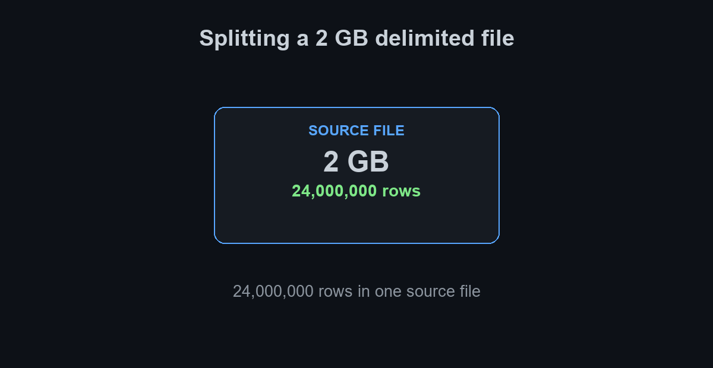

# Delimited File Split Utility

[](https://github.com/cbragdon/ADF_Performance_Toolkit/actions/workflows/test.yml)

`split_delimited_file.py` divides one delimited file into an exact number of
smaller files.
It is intended to prepare evenly sized source files for Azure Data Factory load
tests without loading the complete source file into memory.

The script makes two streaming passes over the source: one to count logical
data records and another to write them. By default, every output file includes
the source header. Use `--no-header` when every record is data. Python's CSV
parser preserves records whose quoted fields contain embedded line breaks.

## Requirements

- Python 3.9 or later
- A delimited text file, with or without a header row

No third-party packages are required.

## Usage

Run the script from the repository root:

```powershell
python .\scripts\split_delimited_file.py <source-file> [options]
```

### Usage examples

Split a headered CSV into the default four output files:

```powershell
python .\scripts\split_delimited_file.py .\data\customers.csv
```

Split a headerless pipe-delimited file into four output files:

```powershell
python .\scripts\split_delimited_file.py .\data\events.psv --delimiter "|" --no-header
```

Create eight pipe-delimited files in a load-test input directory:

```powershell
python .\scripts\split_delimited_file.py .\data\sales.psv --parts 8 --output-dir .\data\load-test-input --delimiter "|"
```

### Options

| Option | Default | Description |
| --- | --- | --- |
| `--output-dir` | `split_output` | Directory to receive the generated files. |
| `--parts` | `4` | Exact number of output files to create. Must be at least `1`. |
| `--encoding` | `utf-8-sig` | Source and output encoding. The default supports UTF-8 files with or without a BOM. |
| `--delimiter` | `,` | Single-character field delimiter. |
| `--quotechar` | `"` | Single-character quote character. |
| `--has-header` | Enabled | Treat the first record as a header and write it to every output file. |
| `--no-header` | Disabled | Treat every record as data; output files contain no header row. |

## Examples

### Animated split summary

This animation illustrates a 2 GB delimited source file containing 24,000,000
rows. It shows the splitter planning and validating an even four-way split:
four 500 MB files containing 6,000,000 rows each.



```powershell
python .\scripts\split_delimited_file.py .\data\load_test_input.psv --parts 4 --output-dir .\data\split_output --delimiter "|"
```

The actual file size and row count depend on the input. The animation uses the
24,000,000-row example above to show how the reported planned and validated
counts relate to four output files.

Split a source into four files in the default `split_output` directory:

```powershell
python .\scripts\split_delimited_file.py .\data\customers.csv
```

Create eight files in an explicit location for a load test:

```powershell
python .\scripts\split_delimited_file.py .\data\sales.csv --parts 8 --output-dir .\data\load-test-input
```

Split a pipe-delimited CSV that uses Windows-1252 encoding:

```powershell
python .\scripts\split_delimited_file.py .\data\events.psv --parts 3 --output-dir .\data\events-split --delimiter "|" --encoding "cp1252"
```

Split a headerless pipe-delimited source. Its first record is treated as data:

```powershell
python .\scripts\split_delimited_file.py .\data\events.psv --parts 3 --output-dir .\data\events-split --delimiter "|" --no-header
```

The output files preserve the source file extension. For example, splitting 10
data records from `customers.csv` into 3 parts creates files containing
4, 3, and 3 data records respectively, plus the header in each file. Output
names follow this pattern:

```text
customers_part_01_of_03.csv
customers_part_02_of_03.csv
customers_part_03_of_03.csv
```

The script prints planned and written record counts, then verifies that every
source record was written exactly once. An empty source file is rejected.

## Verification

The [GitHub Actions test workflow](https://github.com/cbragdon/ADF_Performance_Toolkit/actions/workflows/test.yml)
runs on every push and pull request. It tests comma-delimited CSV and
pipe-delimited text input, confirms that headers are preserved when present,
validates headerless input, validates the 2/1/1/1 distribution of five records
across four files, and verifies quoted fields containing embedded newlines.

To run the same checks locally:

```powershell
python -m unittest tests/test_split_delimited_file.py -v
```
